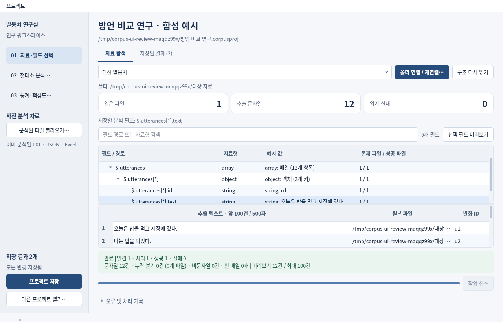
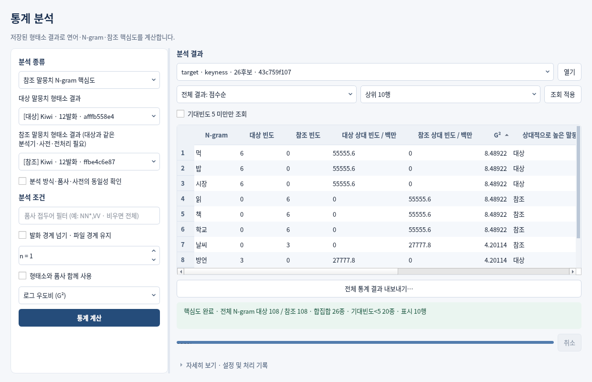
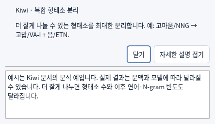
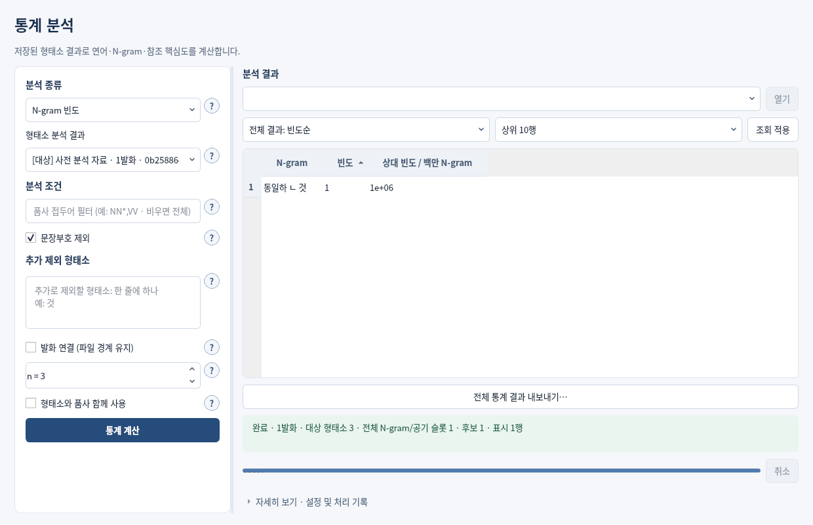

# 말뭉치 연구실

Python / PyQt6 한국어 JSON · TXT · Excel 말뭉치 탐색·형태소·연어·N-gram 분석 데스크톱 프로그램입니다. 저장소에는 처음에 제목만 있는 README가 있었고 기존 구현·의존성·실제 말뭉치는 없었습니다.

## 최근 수정 (v0.6.3)

- 한글 글꼴은 설치된 한국어 글꼴을 우선합니다. Windows에서는 맑은 고딕을 먼저 선택하고, 본문은 운영체제 배율에 맞는 포인트 크기를 사용합니다. 시작 화면은 세로 안내와 스크롤 배치로 변경해 문구 잘림을 줄였습니다.
- **대상 말뭉치만으로 N-gram 빈도를 계산할 수 있습니다.** 대상 형태소 분석을 마치거나 이미 분석된 파일을 불러온 뒤, 왼쪽 **연어·N-gram…** → **N-gram 빈도 · 단일 말뭉치** → 대상 결과 선택 → n 지정 → **N-gram 빈도 계산**을 누르세요. 참조 폴더·필드·형태소 결과는 필요하지 않습니다. 참조 결과가 필요한 기능은 **참조 말뭉치 N-gram 핵심도**입니다.

참조 결과 없이 이전 핵심도 설정만 남아 있으면 통계 화면을 단일 말뭉치 N-gram으로 엽니다. [화면 예시와 검증 범위](docs/v063-validation.md)

## 화면 (v0.6)

밝은 배경과 남색 포인트로 화면을 정리했습니다. 왼쪽 메뉴에서 자료 선택 → 형태소 분석 → 통계 분석 순서로 이동합니다. 자료 화면에는 읽은 파일·추출 문자열·실패 건수가 표시되며, 필드 경로 또는 자료형으로 구조 트리를 검색할 수 있습니다. 검색은 현재 분석 필드와 결과를 바꾸지 않습니다.



형태소·통계 화면은 **왼쪽 설정 / 오른쪽 결과**로 나뉩니다. 가운데 구분선을 끌어 폭을 조절하고, 작은 창에서는 설정을 스크롤하세요. 자료 화면에서도 구조 트리와 미리보기 사이의 구분선을 조절할 수 있고, 공간이 부족하면 자료 영역을 스크롤합니다. 결과 표는 가로 스크롤, 전체 셀 툴팁, 행 선택 후 Ctrl+C 복사를 지원합니다. 전체 결과는 내보내기를 사용하세요.



**저장된 결과** 탭에서 항목을 두 번 클릭하거나 선택 후 열기를 누르면 저장 당시 결과를 다시 엽니다. 상세 설정과 처리 기록은 하단 **자세히 보기**에서 펼칩니다. 읽기 오류 또는 작업 실패 시 오류 내용이 자동으로 펼쳐집니다. 단축키는 새 프로젝트 Ctrl+N, 열기 Ctrl+O, 저장 Ctrl+S입니다.

화면은 합성 예시이며 실제 연구 자료를 포함하지 않습니다. 프로젝트 저장 형식과 통계 계산 기준은 기존과 같습니다. [UI 검증 기록](docs/v06-validation.md)

### 처음 사용하는 분을 위한 도움말 (v0.6.1)

설정 옆의 **?**에 마우스를 올리면 짧은 설명이 나오고, 클릭하면 예시를 볼 수 있습니다. **자세히 보기**에는 사용 시 고려할 점과 통계 계산 기준이 표시됩니다. Tab으로 ?에 이동한 뒤 Space로 열 수도 있습니다.

형태소 분석에서는 Kiwi의 받침 정규화·복합 형태소 분리·호환 자모, 사용자 사전 형식, 바른의 키·보정·서버 사전, 로컬 모델의 스레드·동형이의어 번호·고유명사 사전·캐시, UTagger 버전을 설명합니다. 분석기를 바꾸면 지원하는 옵션과 해당 도움말만 표시됩니다. 분석을 실행할 수 없는 상태에서도 도움말을 읽을 수 있습니다.

자료 화면의 대상/참조·텍스트 필드와 통계 화면의 N-gram·품사·경계·연어 범위·MI/t-score/logDice·G²/χ²에도 도움말이 있습니다. 설명은 현재 앱의 집계 기준을 따릅니다. [검증 기록](docs/v061-help-validation.md)



### 통계에서 문장부호·특정 형태소 제외 (v0.6.2)

통계 화면에서 **문장부호 제외**를 체크하면 따옴표·물음표 등으로만 된 형태소가 제외됩니다. **추가 제외 형태소**에는 `것`이나 기타 기호처럼 빼고 싶은 형태소를 한 줄에 하나씩 적으세요. 이후 선택한 종류의 계산 버튼(예: **N-gram 빈도 계산**)을 다시 누릅니다. N-gram·연어·참조 핵심도에 모두 적용되며, 설정은 프로젝트·결과·내보내기에 보존됩니다. N-gram은 제외 후 남은 형태소를 이어 묶고, 연어는 원래 위치의 탐색 거리를 유지합니다. [자세한 집계 기준](docs/statistics.md) · [검증 기록](docs/v062-exclusions-validation.md)



## 현재 구현 범위

- 시작 화면에서 연구 이름과 저장 위치를 지정하여 프로젝트 생성, 저장, 다시 열기
- 대상 / 참조 말뭉치를 각각 연결하고 개별 JSON 필드 선택
- 프로젝트에 폴더·필드·분석기 설정·분석 설정·결과 목록을 보존하는 버전 1 저장 형식
- 폴더 이동 시 재연결 (선택 필드는 유지), 프로젝트와 말뭉치를 함께 이동하면 상대 경로 복원
- 하위 폴더의 JSON / TXT / XLSX / XLS를 파일별 처리, 손상·인코딩 오류는 기록하고 계속 진행
- 구조 트리에 중첩 객체·배열, 정확한 경로, 자료형, 예시, 필드 존재 파일 수 표시
- 필드 클릭 시 실제 추출 건수와 텍스트·원본 경로·발화 ID 미리보기
- QThread 작업, 처리/성공/실패 건수, 취소, 부분 결과 표시, 취소 후 재실행

**Kiwi, 바른 API, 바른 로컬(baropy), pyutagger 어댑터를 지원합니다.** `형태소 분석…`에서 각 분석기의 설치/입력 상태를 확인하고 실행합니다. 바른은 직접 입력한 API 키, UTagger는 별도 설치한 바이너리·모델이 필요합니다. 이미 분석된 TXT/JSON/Excel을 불러와 재분석 없이 연어(MI/t-score/logDice)·N-gram 빈도를 살펴볼 수 있습니다. 참조 말뭉치 N-gram 핵심도(G²/χ²), 전체 결과 Excel/CSV 내보내기를 지원합니다.

## 설치와 실행

Python 3.10 이상과 데스크톱 화면이 필요합니다. 검증 환경은 Linux / Python 3.12.14 / PyQt6 6.12.1입니다.

```bash
cd /workspace/my_corpus
python3 -m venv .venv
source .venv/bin/activate
python -m pip install -r requirements.txt
python -m pip install -e '.[morphology,test]'
python -m corpus_app
```

설치 후 `corpus-desktop` 명령으로도 실행할 수 있습니다. Windows는 `.venv\Scripts\activate`로 가상환경을 활성화하세요. Linux에서 `xcb` 관련 오류가 발생하면 배포판의 Qt6 GUI 런타임 라이브러리가 필요할 수 있습니다. 화면이 없는 서버에서는 아래 offscreen 테스트로 실행을 검증할 수 있지만 사용자용 창은 나타나지 않습니다.

```bash
QT_QPA_PLATFORM=offscreen python -m pytest -q -s
```

## 사용 순서

1. **새 연구 프로젝트 만들기** → 이름 → `.corpusproj` 저장 위치를 지정합니다.
2. **폴더 연결 / 재연결**에서 말뭉치 폴더를 지정합니다. `examples/corpus`로 시작할 수 있습니다.
3. 구조 트리의 `$` → `$.utterances` → `$.utterances[*]`를 펼치고 `$.utterances[*].text`를 클릭합니다.
4. 실제 문자열 추출 건수와 앞 100건을 확인합니다. `비문자열`과 `누락 분기`도 확인하세요.
5. 필요하면 상단에서 **참조 말뭉치**로 바꿔 다른 폴더와 필드를 지정합니다.
6. **프로젝트 저장** 또는 Ctrl+S 후 다시 열면 연결과 필드가 복원되고 재탐색/미리보기를 실행합니다.
7. 폴더가 없어졌다는 안내가 나오면 **폴더 연결 / 재연결**에서 새 위치를 지정하고 저장합니다.

필드 선택이나 폴더 변경 후에는 저장이 필요합니다. 변경을 저장하지 않고 프로젝트를 바꾸거나 종료하면 저장 여부를 묻습니다. 원본 말뭉치 파일은 읽기 전용으로 취급합니다. 실패 이유는 하단에 최대 100건 표시합니다.

## 경로와 집계 기준

- `$`는 루트, `[*]`는 배열의 모든 항목입니다. 예: `$.utterances[*].text`.
- 점이나 대괄호가 포함된 실제 키는 `$["a.b"]["[*]"]`처럼 표시합니다. 내부에는 키 목록과 배열 와일드카드를 구분해 저장하므로 경로 충돌이 없습니다.
- `존재 파일 / 성공 파일`의 분모는 해당 탐색에서 정상적으로 읽은 JSON 파일 수입니다. 한 파일 내 같은 배열 필드가 여러 번 등장해도 존재 파일 수는 한 번 증가합니다. 취소 결과의 분모는 부분 처리분입니다.
- `문자열`: 선택 경로의 문자열 값 수 (빈 문자열 포함). `비문자열`: 경로에 도달했지만 문자열이 아닌 값 수.
- `누락 분기`: 탐색 도중 키가 없거나 기대한 객체/배열 구조가 아닌 분기 수. 한 파일의 여러 발화에서 누락되면 여러 번 셉니다. 괄호에는 누락 분기가 발생한 파일 수도 표시합니다.
- `빈 배열`: 선택 경로를 탐색하다 만난 빈 배열 수. 문자열 누락과 구분합니다.
- ID는 가장 가까운 상위 객체의 `utterance_id`, `utteranceId`, `id` 순서로 찾습니다. 없으면 상위 객체의 ID를 상속하고, 전혀 없으면 빈 칸입니다. 발화 ID 체계가 다른 자료는 후속 ID 필드 선택 확장이 필요합니다.
- JSON은 UTF-8 / UTF-8 BOM을 지원합니다. NaN/Infinity 등 비표준 JSON 상수는 읽기 실패로 표시합니다.

## 대용량 처리와 한계

전체 말뭉치를 메모리에 적재하지 않습니다. JSON 문서는 **한 파일씩** 파싱하고 구조만 합칩니다. TXT는 줄별로, XLSX는 read-only 행 반복으로 처리합니다. 구형 XLS는 xlrd의 on-demand 시트 읽기를 사용하므로 한 시트가 메모리에 적재될 수 있습니다. 큰 Excel 자료는 XLSX를 권장합니다. 구조는 최대 10,000개 경로, 경로별 자료형별 예시는 최대 160자, 텍스트 미리보기는 100행 × 500자로 제한합니다. 구조 제한에 도달하면 화면에 일부 생략을 표시합니다. 원문은 잘라 쓰거나 수정하지 않습니다.

한 개의 거대한 JSON 파일 자체는 Python `json.load`가 메모리에 올립니다. 취소는 파일 사이와 구조/배열 순회 중 확인하며, 실행 중인 단일 파일 읽기/JSON 파싱을 강제로 끊지는 않습니다. 탐색 총량을 먼저 세기 위한 별도 전체 순회를 피하므로 진행바는 진행 중 표시와 처리 건수를 사용합니다. 폴더는 읽는 동안 변경하지 않는 것이 좋습니다. 심볼릭 링크 디렉터리는 따라가지 않습니다.

프로젝트 파일은 작은 설정 메타데이터용으로 원자적으로 저장합니다. 형태소 결과는 프로젝트 옆 `.results` 폴더의 SQLite DB로 저장하고 프로젝트에는 상대 경로·설정을 기록합니다. DB에는 전체 원문과 형태소/품사 목록이 발화별로 저장되며, 화면에는 앞 100발화만 표시합니다.

## 구성과 후속 구현

| 경로 | 역할 |
| --- | --- |
| `corpus_app/presentation.py` | 공통 테마, 설정/결과 배치, 상태·기록·표 표시 |
| `corpus_app/ui.py` | 시작 화면, 프로젝트/말뭉치 UI, Qt 작업 수명 관리 |
| `corpus_app/project.py` | 프로젝트 형식 검증, 상대 경로, 원자 저장 |
| `corpus_app/json_corpus.py` | Qt와 독립된 구조 합산, 경로 추출, 진행/취소, 오류 집계 |
| `corpus_app/input_formats.py` | JSON / TXT / Excel 파일별·줄별·행별 읽기 |
| `corpus_app/workers.py` | JSON 작업의 QThread 브리지 |
| `corpus_app/analyzers/` | Kiwi 실제 어댑터, 분석기 가용성 및 지원 옵션 |
| `corpus_app/morphology.py` | JSON 내용 지문, SQLite 결과 저장/읽기/재사용 |
| `corpus_app/morph_ui.py` | 형태소 설정·결과·취소 전용 창 |
| `corpus_app/statistics/analysis.py` | SQLite 집계, 연어 점수, N-gram, 정렬/미리보기 |
| `corpus_app/statistics/keyness.py` | 분석 설정 비교, N-gram 집계 캐시, G²/χ² 핵심도 |
| `corpus_app/exporting.py` / `export_ui.py` | 전체 결과 스트리밍 내보내기, 설정, 취소·출력 교체 |
| `corpus_app/tagged_import.py` | 사전 분석 TXT/JSON/Excel/앱 SQLite 가져오기 |
| `corpus_app/analysis_ui.py` | 사전 분석 가져오기 및 통계 화면 |
| `tests/` | 프로젝트/추출 단위 테스트와 실제 Qt 이벤트 루프 통합 테스트 |
| `scripts/generate_corpus.py` | 혼합 구조·손상 파일 포함 합성 데이터 생성 |

저장한 발화별 형태소 결과를 연어·N-gram·참조 핵심도에서 재사용하고 전체 결과를 Excel 또는 UTF-8 BOM CSV로 내보냅니다. API 키는 분석 설정과 분리합니다. [빈도 집계와 통계식](docs/statistics.md)을 확인하세요.

## 합성 3,000개 재현

새 폴더를 사용하세요. 생성기는 기존 파일을 덮어쓰지 않습니다.

```bash
python scripts/generate_corpus.py /tmp/corpus-3000
```

생성 내용: 전체 3,000개, 손상 JSON 4개, 정상 JSON 2,996개, 그중 다른 구조 230개. `$.utterances[*].text`에 문자열 82,980건이 있습니다. 정상 스키마와 손상 스키마, 폴더 복원, Qt 타이머 응답 및 취소를 자동 테스트합니다. 실제 수행 결과와 검증 범위는 [docs/validation.md](docs/validation.md)에 기록합니다.

## Kiwi 형태소 분석 사용법

1. 대상 말뭉치의 분석 필드를 선택한 뒤 **형태소 분석…**을 누릅니다.
2. **Kiwi**를 선택합니다. 사용 가능 상태는 패키지 설치 여부이며, 실제 모델 초기화 실패는 작업 오류에 표시합니다.
3. 받침 정규화(`normalize_coda`), 복합 형태소 분리(`split_complex`), 호환 자모 출력(`compatible_jamo`)을 필요에 따라 선택합니다. 기본값은 모두 꺼짐입니다.
4. 사용자 사전은 한 줄에 `형태소 품사 [점수]`를 입력합니다. 예: `코덱스방언연구 NNP 100`. 빈 줄과 `#` 주석을 지원합니다. 점수는 유한한 숫자여야 하고, 품사는 Kiwi가 지원하는 태그여야 합니다. 사전 내용 자체를 저장하므로 외부 사전 파일 이동에 영향받지 않습니다.
5. **설정 저장** 또는 **형태소 분석 / 같은 데이터·설정 결과 재사용**을 누릅니다. 이 버튼은 프로젝트도 저장합니다. 대상/참조는 하나의 프로젝트 분석기 설정을 공유합니다.
6. 완료하면 원문, 형태소/품사, 원본 경로, 발화 ID와 전체 형태소 수가 표시됩니다. 화면은 앞 100발화, 발화당 앞 100형태소/1,500자로 제한하지만 DB에는 전체 결과가 남습니다.
7. 다시 연 프로젝트에서 **형태소 분석… → 저장한 결과 열기**로 복원합니다. 원본 폴더가 없어도 저장 당시 결과를 열 수 있습니다. 아래에는 그 결과를 만들 때 사용한 설정이 별도로 표시됩니다.

### 저장·재사용·취소 기준

- 결과는 `연구.corpusproj` 옆의 `연구.results/<SHA256>.sqlite`에 원자적으로 저장합니다. 프로젝트를 옮기거나 공유할 때 **프로젝트 파일과 `.results` 폴더를 함께** 복사하세요. 결과 폴더에는 원문이 포함되며 Git에서는 기본 제외합니다.
- 폴더 절대 경로, 파일 상대 경로 및 전체 바이트의 SHA-256, 선택 필드, 분석기/모델 버전, 옵션, 사전 내용, 전처리 기준으로 캐시를 구분합니다. 시간·파일 크기만 비교하지 않습니다. 폴더 재연결 후에는 새 경로로 재분석합니다.
- 전처리는 현재 `identity`(변경 없음), 발화별 분석, 품사 전체 유지입니다. 고정 모델은 Kiwi 0.24.1의 **CoNg**, 스레드 수는 1입니다. 방언 특화 성능을 보장하지 않으며, 모델이 돌려준 품사를 그대로 보존합니다.
- 손상 JSON은 건너뛰고 오류를 표시합니다. 실패 파일이 포함된 결과는 보관할 수 있지만 자동 캐시 재사용 대상에서는 제외합니다. 분석기 오류는 작업 전체를 중단합니다.
- 데이터 내용 확인, 모델 초기화, 분석, SQLite 저장/읽기는 QThread에서 실행합니다. 취소/닫기는 현재 파일 파싱·모델 초기화·한 발화 분석이 끝난 뒤 반영되며, 취소되거나 실패한 작업의 임시 DB는 삭제합니다. 기존 완료 결과는 보존합니다.
- **저장한 결과 열기**는 원본과 대조하지 않는 과거 결과 보기입니다. 현재 데이터와 일치하는지 확인하려면 분석 버튼을 사용하세요. 프로젝트 JSON만 수정해도 SQLite 내부의 원래 분석 설정은 바뀌지 않습니다.

검증 내용은 [2단계 검증 기록](docs/morphology-validation.md)을 참고하세요.

## TXT · Excel 불러오기

JSON과 같은 **폴더 연결 / 재연결**을 사용합니다. 서로 다른 형식이 섞인 폴더도 지원합니다. 선택 필드는 말뭉치당 하나이므로 구조가 전혀 다른 자료는 각각 대상/참조로 연결하거나 별도 프로젝트를 사용하세요.

| 파일 형식 | 추출 단위 | 선택 경로 예 |
| --- | --- | --- |
| JSON | 사용자가 선택한 경로 | `$.utterances[*].text` |
| TXT | 비어 있지 않은 한 줄 | `$.text` |
| Excel (.xlsx / .xls) | 선택 시트의 한 행, 선택한 한 열 | `$.sheets["발화"].rows[*]["B: 발화"]` |

- TXT는 UTF-8/BOM을 먼저 검증한 뒤 UTF-8이 아니면 CP949로 읽습니다. 디코딩 오류는 실패 파일로 표시합니다. 빈 줄/공백만 있는 줄은 제외하고 나머지 앞뒤 공백은 보존합니다. 발화 ID는 `line:원본줄번호`입니다.
- Excel은 **각 시트의 첫 행을 열 이름**으로 사용합니다. 중복/빈 열 이름을 구분하기 위해 `A: id`, `B: 발화`처럼 열 문자를 붙입니다. 비어 있는 행은 제외합니다. 데이터가 없는 시트는 선택할 텍스트 필드가 나타나지 않을 수 있습니다.
- Excel의 숫자·날짜를 자동으로 텍스트로 바꾸지 않습니다. 선택한 열의 문자열만 추출하고 나머지는 비문자열로 집계합니다. XLS 날짜는 xlrd의 원래 숫자 값으로 읽으며 분석 대상 문자열로 간주하지 않습니다.
- `utterance_id`, `utteranceId`, `id`, `발화 ID`, `발화ID` 헤더가 있으면 그 값을 ID로 사용하고, 없으면 `시트이름!행번호`를 연결합니다.
- XLSX 수식은 Excel이 마지막으로 저장한 **캐시 값**을 사용합니다. 수식을 계산하지 않습니다. 값이 비어 있으면 Excel에서 계산 후 저장하거나 값으로 붙여넣은 파일을 사용하세요. 암호가 걸린 파일은 지원하지 않습니다.
- 원본은 수정하거나 JSON으로 변환 저장하지 않습니다. 합성 예시는 `examples/formats/utterances.txt`, `utterances.xlsx`, `legacy.xls`입니다.
- 기존 프로젝트와 선택 필드 형식은 그대로 호환됩니다. TXT/Excel도 동일한 분석기 설정·결과 저장·취소 경로를 사용합니다. Kiwi/UTagger는 내용 기반 자동 재사용, 바른은 저장 결과 수동 열기를 지원합니다.

## 바른 API: 창에 API 키 직접 입력

1. 최신 `requirements.txt`를 설치하고 **형태소 분석… → 바른 API**을 선택합니다.
2. 비밀번호 형태로 표시되는 **바른 API 키** 칸에 본인의 키를 입력합니다. `.env`나 환경 변수 설정은 필요하지 않습니다. 키 발급/확인: https://bareun.ai/analyze ([공식 SDK 설명](https://pypi.org/project/bareunpy/)).
3. 띄어쓰기 보정(`auto_spacing`), 붙여쓰기 보정(`auto_jointing`)을 선택합니다. 기본값은 둘 다 켜짐입니다. 발화 경계를 유지하도록 서버 문장 자동 분리는 꺼져 있습니다.
4. 필요하면 바른 서버에 이미 등록된 사용자 사전 이름을 쉼표로 입력합니다. 이 앱은 서버 사전을 생성하거나 덮어쓰지 않습니다. Kiwi 사전 입력 형식은 바른에 적용하지 않습니다.
5. **형태소 분석 (API 서버 전송)**을 누릅니다. 원문은 공식 호스팅 주소 `https://api.bareun.ai:443`으로 전송됩니다. API 이용 한도·요금은 바른 서비스 정책에 따릅니다.

키는 열려 있는 분석 창에서만 유지하고 닫으면 지웁니다. 실행 중에는 작업자와 HTTPS 인증 헤더로만 전달하며, 프로젝트 JSON·SQLite 설정·캐시 키·명령행·로그·Git에 넣지 않습니다. SDK 오류가 키를 포함할 수 있어 서버의 원본 오류 메시지 대신 일반 오류 안내를 표시합니다. **설정 저장**은 보정 옵션과 사전 이름만 저장하므로, 창을 다시 열면 키는 다시 입력해야 합니다.

SDK 2.1.0의 공식 Connect RPC 요청/응답 타입을 사용하며 요청당 제한 시간은 30초입니다. 취소는 진행 중인 요청이 돌아오거나 제한 시간에 도달한 뒤 반영됩니다. 빈 발화는 요청하지 않습니다. 서버 모델·계정별 사전 내용이 바뀔 수 있어 바른은 자동 캐시를 쓰지 않고, 실행할 때마다 별도 완료 결과를 보존합니다. **저장한 결과 열기**는 키나 API 요청 없이 사용할 수 있습니다.

## UTagger: pyutagger와 설치된 모델 사용

- Python 래퍼는 `requirements.txt`의 `pyutagger==1.0.1.1031`로 설치됩니다. API 키는 필요하지 않습니다.
- 공식 [pyutagger 설명](https://pypi.org/project/pyutagger/)에 있는 다운로드 단계로 **바이너리와 데이터**도 설치해야 합니다. `pip install pyutagger`만으로는 네이티브 모델이 포함되지 않습니다.
- 공식 설치 도구는 `~/pyutagger_path.json`에 버전별 모델 경로를 등록합니다. 앱은 그 설정을 읽고, Windows/Linux용 라이브러리 존재 여부를 표시합니다. 설치·갱신한 뒤 분석 창을 다시 여세요.
- 형태소 창에서 `utagger4`, `utagger3`, `utagger4hj` 중 설치한 버전을 선택합니다. `utagger4hj`는 옛한글 전용 모델입니다. 별도의 사용자 사전 편집 UI는 제공하지 않고 설치 모델에 포함된 설정/사전을 사용합니다.
- 공식 `utagger_loader(...).load() / pos()`를 별도 Python 프로세스에서 호출합니다. SDK의 `os.chdir`, `sys.exit`, 네이티브 오류가 주 앱을 종료하거나 작업 폴더를 바꾸지 않게 합니다. 모델 로드는 최대 120초, 한 발화는 최대 30초 기다립니다.
- SDK가 반환한 `배__05/NNG` 같은 어깨번호를 포함한 형태소 표기를 그대로 보존합니다. 모델 폴더의 파일 내용 지문을 저장하므로 사전/모델 파일이 바뀌면 캐시를 재사용하지 않습니다.

이 클라우드에서는 Python SDK만 설치했고 UTagger 바이너리·모델은 등록되어 있지 않습니다. 공식 SDK 다운로드 코드는 HTTP 배포 목록을 사용하며 새 다운로드에 검증된 체크섬을 강제하지 않아, 앱이 이를 자동 실행하지는 않습니다. 공식 배포 자료를 준비한 로컬 환경에서 로드 상태를 확인할 수 있습니다.

바른 실제 인증 호출과 UTagger 실제 모델 출력은 이 환경에서 검증하지 않았습니다. SDK 계약·키 비저장·서브프로세스 경로 테스트 결과는 [분석기 연동 검증](docs/analyzer-validation.md)에 기록합니다.

## 바른 로컬 (baropy)

원격 **바른 API**와 별개로 **형태소 분석… → 바른 로컬 (baropy)**을 선택할 수 있습니다. `bareun-baropy==3.4.1`은 서버 바이너리를 포함하고 **모델은 첫 실행에 다운로드**합니다. API 키는 로컬 방식에서도 필요하며, 창에 직접 입력합니다. `.env` 설정은 없습니다. 기본 모델 시작 대기 한도는 30분이고 CPU 스레드 기본값은 2입니다. 원문 분석은 PC의 숨은 루프백 서버에서 수행하지만 첫 키 등록·라이선스 확인·모델 다운로드는 네트워크가 필요합니다.

- 지원 환경은 공식 wheel 기준 Python 3.10+, Linux x86_64/aarch64, macOS Apple Silicon, Windows x64/ARM64입니다. 실제 설치 가능 여부는 OS·CPU·런타임에 따릅니다. 없는 경우 `python -m pip install -e '.[baropy]'`로 설치하세요.
- API용 띄어쓰기/붙여쓰기 보정과 원격 사전 이름은 표시하지 않습니다. 로컬에서 제공하는 스레드 수, 의미 어깨번호 포함, **한 줄 한 단어의 고유명사 사전**, 모델 캐시 경로를 표시합니다. 고유명사는 임시 로컬 사전에만 등록하고 기존 원격 사전을 덮어쓰지 않습니다.
- SDK가 키를 `var/api-keys.db.pb`에 등록하는 것을 확인했습니다. 앱은 별도 비공개 `.corpus-session-*` 폴더에서 SDK를 실행하고 **종료/취소 시 등록 DB·라이선스·로그·로컬 사전을 삭제하며 모델만 보존**합니다. 따라서 로컬 SDK의 실행 중 키가 메모리에만 존재한다고 보장하는 방식은 아닙니다. 프로젝트·분석 DB·캐시 식별자·명령행·환경 변수에는 키를 저장하지 않습니다.
- 기본 모델 캐시는 OS 임시 폴더의 `corpus-desktop-baropy-models`입니다. 장기 보관하려면 말뭉치 폴더 밖의 전용 경로를 지정하세요. 모델 디렉터리를 세션 안으로 잠시 옮겼다가 서버 종료 후 돌려놓으며, 같은 캐시를 쓰는 동시 분석은 잠금으로 차단합니다. 파일 이동 실패 시 모델을 보존하고 정리 실패를 알립니다.
- 작업 프로세스와 숨은 서버를 분석 작업에 묶고 취소 시 종료합니다. 최초 모델 대기 중에도 앱이 응답하며 취소 요청을 확인합니다. 정상 종료 후 모델만 재사용할 수 있지만, 모델 버전을 고정 확인하지 못하므로 **분석 결과 자동 캐시는 사용하지 않고 실행별 결과를 저장**합니다. 저장 결과 수동 열기에는 키가 필요 없습니다.
- 프로세스 강제 종료/OS 종료 시 `.corpus-session-*`이 남을 수 있습니다. 다음 사용 전 앱과 로컬 서버가 종료됐는지 확인하고, 남은 세션의 `var/models`를 보존한 뒤 임시 등록 정보·로그를 정리하세요. 공유·Git 업로드 대상에 이 캐시를 넣지 마세요.

실제 키가 없어 네이티브 모델 다운로드/정확도는 아직 검증하지 않았습니다. 실제 SDK의 자식 서버 프로토콜과 등록/종료는 루프백 시험 서버로 검증했고, 별도 프로세스·모델 보존·키 정리·취소 경로도 테스트했습니다. 상세: [v0.4 검증](docs/v04-validation.md).

## 이미 분석된 파일로 바로 연어 · N-gram 보기

원본 폴더를 연결하거나 분석기/API 키를 설정하지 않고 시작할 수 있습니다.

1. 새 프로젝트를 만든 뒤 **이미 분석된 형태소·품사 파일 불러오기…**를 누릅니다.
2. 기본 형식 **TXT: 형태소/품사 (한 줄=발화)**에서 `examples/tagged/utterances.pos.txt` 또는 자신의 파일을 선택합니다. 여러 파일을 한 번에 선택할 수 있습니다.
3. **불러오기 · 프로젝트에 결과 등록**을 누르면 형태소·품사를 변경하지 않고 저장합니다. UTF-8/BOM·CP949를 지원하며 실패 파일은 건너뛰고 이유를 표시합니다.
4. **연어 · N-gram 분석…**에서 방금 불러온 결과를 선택합니다. 기존 Kiwi/바른/UTagger 분석 결과도 같은 목록에서 사용할 수 있습니다.
5. N-gram은 `n`(1~10), 형태소만/품사 포함, 품사 필터, 발화 경계를 설정합니다. 연어는 중심어를 지정하거나 비워서 전체 쌍을 보고, 좌우 범위·품사·최소 공기 빈도·지표를 설정합니다.
6. 계산 결과와 설정을 프로젝트에 저장합니다. 다시 연 프로젝트에서 **저장 통계 열기**로 확인합니다. **정렬/표시 적용**은 저장된 전체 후보에서 빈도/점수순 상위 10·100·1,000행을 조회합니다. 표 머리글 정렬은 현재 미리보기 안에서만 수행합니다.

TXT 입력 예:

```text
밥/NNG 을/JKO 먹/VV 다/EF
커피/NNG 를/JKO 마시/VV 다/EF
```

한 줄은 한 발화, 공백/탭은 토큰 구분자, 마지막 `/`는 품사 구분자입니다. `//SP`는 형태소 `/`, 품사 `SP`입니다. `배__05/NNG` 같은 어깨번호도 그대로 보존합니다. `밥/NNG+을/JKO` 형식이라면 **+ 연결도 분리**를 켜세요. 기본값에서는 +를 자동 분리하지 않습니다. 품사가 빠졌거나 비어 있으면 파일 전체를 실패 처리하고 그 파일에서 앞서 읽은 발화도 취소합니다. 다른 파일은 계속 처리합니다.

다른 입력 형식:

| 형식 | 설정 / 발화 단위 |
| --- | --- |
| JSON | `$.utterances[*].tokens` 등 **발화별 토큰 배열** 경로와 형태소/품사 키를 지정. `[{"form":"밥","pos":"NNG"}]` 또는 `[["밥","NNG"]]` 허용. 배열 하나가 한 발화이며 빈 배열도 경계로 보존 |
| TSV | 헤더 없이 `형태소<TAB>품사`, 빈 행으로 발화 구분 |
| Excel | 헤더의 형태소·품사·ID 열을 선택. 같은 ID의 연속 행을 한 발화로 묶으며 파일/시트 변경 시 경계 유지. ID 열을 비우면 시트 전체가 한 발화. 중복 헤더는 A/B 같은 열 문자 사용 |
| 앱 SQLite | 이 앱에서 저장한 형태소 결과를 복사해 등록. 기존 파일은 수정하지 않음 |

가져온 자료의 품사 체계를 자동 추정·변환하거나 원문을 재분석하지 않습니다. TXT/JSON/Excel의 화면 텍스트는 **형태소를 공백으로 이어 재구성한 것**이며 원래 띄어쓰기/어미 표면형을 복원한 원문은 아닙니다. 실제 토큰 순서·품사·입력 경로·발화 ID는 DB에 보존합니다. JSON은 가장 가까운 ID, TXT는 원래 줄 번호, Excel은 시트/지정 ID를 연결합니다.

통계는 발화별 SQLite 토큰을 순차 읽고 후보 5,000개 단위로 디스크에 집계합니다. 전체 후보를 UI에 올리지 않습니다. 파일 경계는 항상 유지하고, 발화 경계만 명시적으로 넘길 수 있습니다. 결과와 계산식·분모·품사 필터의 차이는 [통계 기준](docs/statistics.md)에 설명했습니다. 참조 핵심도와 내보내기는 아래 절을 참고하세요.

## 참조 말뭉치 N-gram 핵심도 (G² / χ²)

1. 대상 말뭉치를 연결하고 필드를 선택해 형태소 분석합니다. 상단을 **참조 말뭉치**로 바꾸어 참조 폴더와 필드를 별도로 선택하고 **같은 분석기·사전·옵션**으로 분석합니다. 폴더/JSON 필드 경로는 서로 달라도 됩니다. 사전 분석 TXT를 대상/참조에 각각 불러오는 방식도 가능합니다.
2. **연어 · N-gram · 핵심도 분석…**에서 분석 종류를 **참조 말뭉치 N-gram 핵심도**로 바꿉니다.
3. 대상·참조의 저장된 형태소 결과를 각각 고르고, 공통 `n`, 품사 포함 여부, 품사 필터, 발화 경계와 **G² / χ²**를 선택합니다.
4. 사전 분석 자료 또는 모델 버전이 고정되지 않은 바른 결과라면 생산 방식·품사 체계·전처리·사전이 같은지 확인하고 해당 확인란을 선택합니다. 다른 쌍을 선택하면 확인은 해제됩니다.
5. **통계 계산**을 누르면 두 말뭉치의 같은 차수 전체 N-gram 수를 분모로 비교합니다. 한쪽에서만 등장한 항목도 포함합니다. 표에는 두 빈도·백만 N-gram당 상대 빈도·통계량·대상/참조 방향·최소 기대빈도·기대빈도 5 미만 표시가 나옵니다. 낮은 기대빈도 항목만 보려면 **기대빈도 5 미만 항목만 조회**를 켜고 **정렬/표시 적용**을 누릅니다.
6. 결과와 두 분모·설정·생산자 기록이 프로젝트에 저장됩니다. 다시 열 때 선택한 결과 쌍과 설정을 복원합니다. 한쪽 전체 수가 0이면 비교하지 않은 이유를 빈 결과와 함께 표시합니다.

앱이 생산한 결과는 저장된 분석기·버전·전처리·사전·실제 옵션을 비교하며, 다르면 계산하지 않습니다. 추출 경로, 캐시 폴더, CPU 스레드 수 같은 분석 내용과 무관한 값은 동일성 비교에서 제외합니다. 외부 결과의 생산 과정이나 바른의 서버 모델/계정별 사전 내용은 자동으로 검증할 수 없어 사용자 확인을 기록합니다. 앱 결과와 생산자를 모르는 외부 결과를 섞어 동일한 분석이라고 간주하지 않습니다.

핵심도는 **선택한 형태소 DB 스냅샷**을 비교합니다. 원본을 바꿨다면 먼저 형태소 분석을 다시 하세요. 같은 DB 바이트와 N-gram 설정은 `.results/.ngram-counts`에서 집계를 재사용하고, G²↔χ² 변경은 형태소 분석이나 N-gram 집계를 반복하지 않습니다. 수식과 2×2 표는 [통계 기준](docs/statistics.md), 실제 검증 범위는 [v0.5 검증](docs/v05-validation.md)에 기록합니다.

## Excel / CSV로 전체 결과 내보내기

형태소 분석 창, 사전 분석 파일 가져오기 창, 통계 창에서 **전체 결과 내보내기…**를 누릅니다. 화면에 10행만 보이거나 낮은 기대빈도 항목만 조회 중이어도 저장된 전체 토큰/후보를 내보냅니다. 지금 편집 중인 옵션이 아니라 **선택한 저장 결과를 만들 때의 설정**을 포함합니다. 키나 실행 중인 분석기 객체를 사용하지 않습니다.

| 형식 | 결과와 설정 |
| --- | --- |
| CSV | UTF-8 BOM의 `.csv` 표 + 같은 위치의 `.csv.settings.json` 설정 파일 |
| Excel | `.xlsx`의 `결과_1` 시트와 `분석 설정` 시트. 행 한도를 넘으면 `결과_2` 등으로 자동 분할 |

- 형태소는 토큰별 한 행으로 발화 순번·토큰 순번·원본 파일·발화 ID·형태소·품사를 기록합니다. 원문/재구성 텍스트 포함 여부를 선택할 수 있습니다. 토큰이 없는 발화는 빈 토큰 순번의 한 행으로 보존하며, 설정에 행 기준을 기록합니다.
- 연어에는 좌우 범위·품사·최소 빈도·지표·슬롯 기준을, N-gram에는 `n`·경계·전체 수를, 핵심도에는 대상/참조 생산자·전체 N-gram 수·G²/χ²·동일성 확인 기준을 포함합니다.
- CSV의 텍스트 보호를 켜면 `=`, `+`, `-`, `@` 등으로 시작하는 문자열과 16자리 이상 정수 앞에 `'`를 붙여 Excel이 수식이나 반올림된 숫자로 해석하지 않게 합니다. 원문 그대로의 CSV가 필요하면 해제하세요. 적용 여부는 설정 JSON에 기록됩니다.
- XLSX의 문자열은 수식이 아닌 실제 텍스트로 저장합니다. 16자리 이상 정수도 텍스트로 보존합니다. 한 셀의 32,767자 한도나 지원하지 않는 제어 문자가 있으면 내용을 자르지 않고 실패 이유를 표시합니다. 이때 CSV 또는 원문 포함 해제를 사용할 수 있습니다. 긴 설정 값은 설정 시트에서 번호가 붙은 부분으로 나누어 손실 없이 저장합니다.
- 기존 파일을 고르면 CSV와 설정 파일을 함께 확인한 뒤 덮어씁니다. 쓰기·정렬·압축은 작업자에서 수행하고, 취소된 미완료 파일은 제거합니다. CSV 두 파일 중 교체가 실패하면 기존 파일을 복원합니다. 복원 자체가 실패하면 백업 위치를 알려주고 보존합니다.
- 원본 DB와 알려진 원본 말뭉치 파일은 출력으로 덮어쓰지 않습니다. 내보내기 폴더는 원본 말뭉치 폴더 밖을 권장합니다. API 키와 임시 등록 정보는 내보내기에 포함하지 않습니다.
