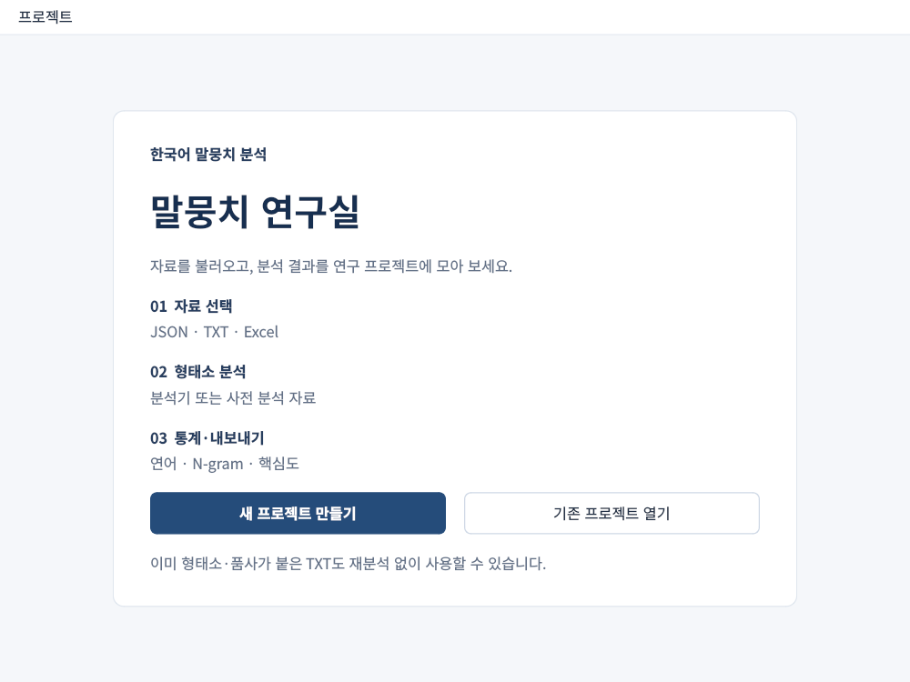
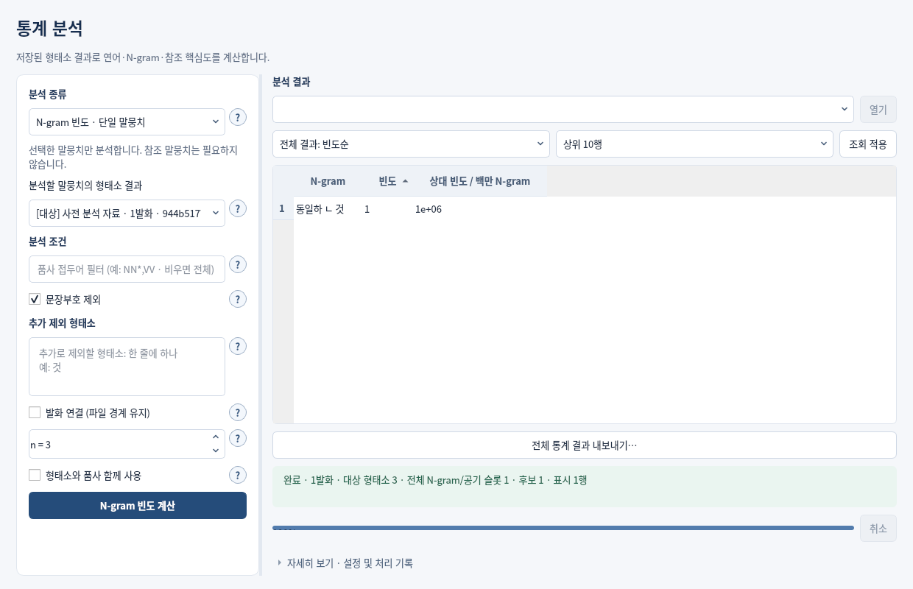

# v0.6.3 한글 표시와 단일 말뭉치 N-gram

2026-11-20, Linux / Python 3.12 / PyQt6 offscreen에서 검증했습니다.

전체 테스트 `python -m pytest -q -W error`: **93 passed**. 새 글꼴 선택·문구 크기·대상 전용 N-gram 회귀 테스트 6개를 포함합니다.

## 한글 표시

영문 글꼴 Segoe UI를 맨 앞에 두던 대체 목록 대신 설치된 한국어 UI 글꼴을 선택합니다. Windows는 Malgun Gothic/맑은 고딕, macOS는 Apple SD Gothic Neo, Linux는 Noto Sans CJK KR 등을 우선합니다. 적합한 글꼴이 없으면 시스템 글꼴을 유지합니다. 본문은 전역 13px 고정 크기를 제거하고 애플리케이션의 포인트 크기를 사용합니다.

시작 화면의 좁은 세 열을 세로 안내로 변경했습니다. 각 안내를 독립 위젯으로 배치해 줄바꿈 높이를 계산하고, 화면이 작으면 스크롤로 접근합니다.

1280×820, 1024×640, 800×600에서 모든 시작 화면 레이블의 실제 높이가 줄바꿈에 필요한 높이 이상인지 확인했습니다. 별도 Qt 프로세스에서 QT_SCALE_FACTOR=1, 1.25, 1.5로 렌더링하고 같은 크기의 창에서 잘린 레이블이 없는 것을 확인했습니다. Windows/macOS의 실제 글꼴 렌더링을 검증한 것은 아닙니다. Windows의 설치 글꼴 선택 순서는 단위 테스트로 확인했습니다.

## 참조 없이 N-gram

N-gram 빈도·연어는 선택한 저장 형태소 결과 하나만 사용합니다. 참조 결과의 검사는 핵심도 비교에만 적용됩니다. 화면에 단일 말뭉치 분석임을 안내하고 계산 버튼 이름을 분석 종류에 맞춰 표시합니다. 참조 결과 없이 핵심도 설정만 남아 있는 프로젝트는 N-gram으로 진입합니다. 유효한 저장 비교 결과가 있으면 핵심도 설정을 유지합니다.

대상 사전 분석 TXT만 불러온 프로젝트를 Qt 창에서 계산했습니다. 참조 폴더·필드·결과가 없는 상태에서 핵심도 함수를 호출하면 실패하도록 막고, n=2의 ‘밥 먹’ 2회, ‘먹 다’ 1회, 전체 3개를 확인했습니다. 프로젝트를 다시 열어 결과를 읽는 것도 확인했습니다. 이전 설정이 N-gram인 경우와 참조가 없는 핵심도인 경우를 각각 검증했습니다.

