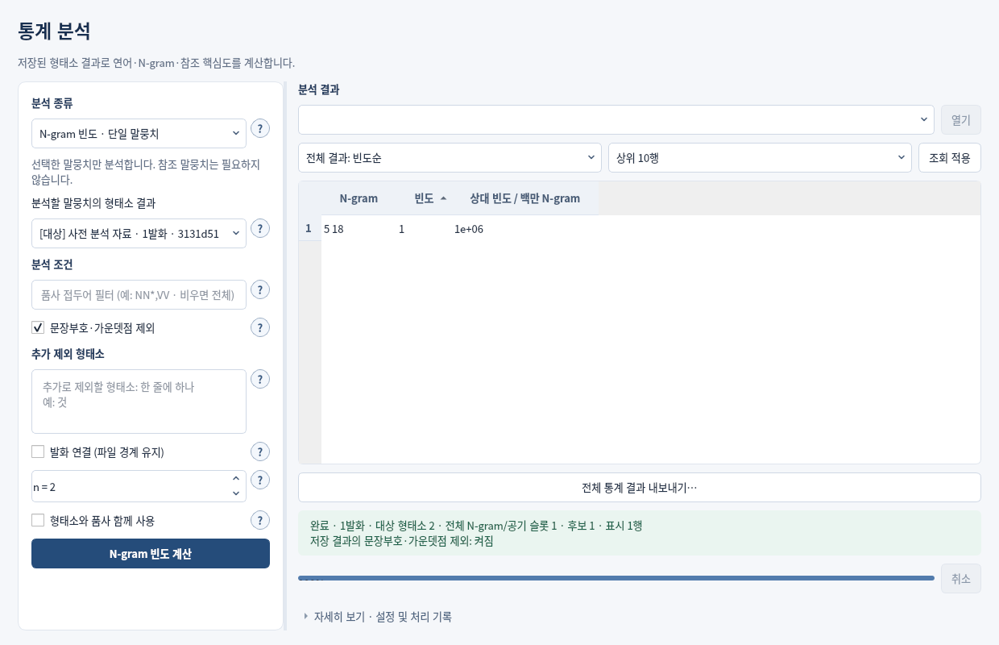

# v0.6.4 가운뎃점 필터 검증

2026-11-20, Linux / Python 3.12 / PyQt6 offscreen에서 전체 테스트 `python -m pytest -q -W error`: **103 passed**.

- 추가한 10개 회귀 테스트에서 `·ㆍᆞ⋅∙・･` 일곱 문자를 각각 NNG로 표기해 품사와 무관하게 제외되는 것을 확인했습니다. `5 점 18`에서 n=2의 결과는 `5 18` 1회, 전체 형태소 2개입니다.
- 한 형태소 안에 점이 섞인 `5·18` 같은 표기와 일반 수학기호 `+`는 보존합니다. 단독 아래아는 제외 대상임을 도움말에 설명하며 자동 제외를 끄고 특정 문자 목록을 쓰는 방법을 안내합니다.
- 연어는 제외 후에도 원래 탐색 거리를 유지합니다. 점을 사이에 둔 두 형태소는 범위 1에서 공기하지 않고 범위 2에서 공기합니다.
- 이전 기준의 메타데이터와 캐시 해시를 가진 실제 집계 파일을 구성했습니다. 새 핵심도 계산에서 이를 재사용하지 않고 양쪽 분모가 2로 줄어드는 것과, 새 기준으로 재계산한 캐시는 지표 변경 시 재사용되는 것을 확인했습니다.
- 결과 요약은 현재 체크 상태가 아닌 저장된 필터 설정을 표시합니다. 이전 기준의 저장 결과에는 재계산 안내가 표시됩니다. 기존 결과 파일은 수정하지 않습니다.
- Qt 화면에서 `5 ㆍ 18` 합성 TXT를 실제로 불러와 계산했고, 1024×640에서 설정 영역의 가로 스크롤 없이 표시되는 것을 확인했습니다.

